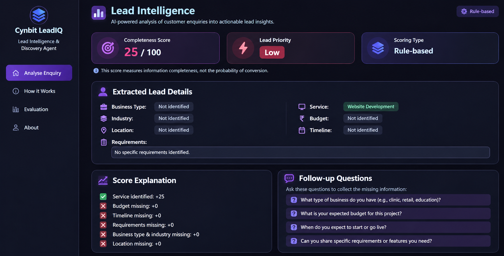

# 🎯 Cynbit LeadIQ

### AI-Powered Lead Intelligence & Discovery Agent

Cynbit LeadIQ is a Python-based prototype that transforms unstructured customer enquiries into structured lead information using requirement extraction, TF-IDF knowledge retrieval, rule-based lead scoring, and automated follow-up question generation.

## 🚀 Key Features

- **Lead Extraction:** Identifies industry, business type, service, location, budget, timeline, and project requirements.
- **Knowledge Retrieval:** Retrieves relevant company information using TF-IDF and cosine similarity.
- **Lead Completeness Scoring:** Calculates a transparent score out of 100.
- **Priority Classification:** Categorizes leads as High, Medium, or Low based on completeness.
- **Follow-up Questions:** Identifies missing information and suggests relevant questions.
- **Interactive Dashboard:** Displays analysis results through a Streamlit interface.

## 🛠️ Technology Stack

| Technology   | Purpose                      |
| ------------ | ---------------------------- |
| Python       | Core development             |
| Streamlit    | Web interface                |
| Scikit-learn | TF-IDF and cosine similarity |
| Pydantic     | Data validation              |
| JSON         | Knowledge base               |
| Pytest       | Automated testing            |

## 🏗️ Project Structure

```text
Cynbit-LeadIQ/
│
├── app.py
├── evaluation.py
├── requirements.txt
├── README.md
│
├── src/
│   ├── __init__.py
│   ├── knowledge_base.py
│   ├── retriever.py
│   ├── lead_extractor.py
│   ├── lead_scorer.py
│   └── discovery_agent.py
│
├── data/
│   ├── company_knowledge.json
│   └── sample_leads.json
│
├── tests/
│   ├── test_lead_extractor.py
│   ├── test_lead_scorer.py
│   └── test_retrieval.py
│
└── reports/
    ├── ai_opportunity_report.md
    ├── technical_approach.md
    └── evaluation_report.md
```

## ⚙️ Installation and Setup

### 1. Clone the repository

```bash
git clone https://github.com/soham2142/Cynbit-LeadIQ.git
cd Cynbit-LeadIQ
```

### 2. Create a virtual environment

```bash
python -m venv .venv
```

### 3. Activate the environment

Windows PowerShell:

```powershell
.\.venv\Scripts\Activate.ps1
```

### 4. Install dependencies

```bash
python -m pip install --upgrade pip
pip install -r requirements.txt
```

### 5. Run the application

```bash
python -m streamlit run app.py
```

Open the application at:

`http://localhost:8501`

## 🧪 Testing

Run the automated test suite:

```bash
python -m pytest -v
```

**Current test status:** 15 tests passed.

## 📊 Evaluation

The prototype was evaluated using a synthetic dataset containing three customer enquiries.

| Evaluation Metric         | Result |
| ------------------------- | -----: |
| Test Cases                |      3 |
| Total Fields Tested       |     15 |
| Correct Fields            |     15 |
| Incorrect Fields          |      0 |
| Field Extraction Accuracy |   100% |

The reported accuracy represents exact-match field extraction performance on this small evaluation dataset. It does not represent overall agent accuracy or real-world performance.

Run the evaluation:

```bash
python evaluation.py
```

Detailed results are saved in `evaluation_results.json`.

## 📈 Lead Scoring Methodology

The system uses a rule-based information completeness score.

| Parameter                  |  Weight |
| -------------------------- | ------: |
| Service                    |      25 |
| Budget                     |      20 |
| Timeline                   |      20 |
| Requirements               |      20 |
| Business Type and Industry |      10 |
| Location                   |       5 |
| **Total**                  | **100** |

Priority levels:

- High: 75–100
- Medium: 45–74
- Low: Below 45

The score measures information completeness, not the probability of customer conversion.

## 🔮 Future Enhancements

- LLM-based requirement extraction.
- Semantic search using embeddings.
- Grounded conversational question answering.
- CRM integration.
- Human approval workflows.
- Larger evaluation datasets.
- Multilingual enquiry processing.

## ⚠️ Limitations

- Current extraction is based on keyword matching and rules.
- TF-IDF retrieval has limited semantic understanding.
- The scoring mechanism is rule-based, not a trained prediction model.
- Evaluation currently uses a small synthetic dataset.

## 👨‍💻 Project Context

Developed as a technical project for the AI/ML Engineer Intern opportunity at Cynbit.

**Project:** Cynbit LeadIQ  
**Category:** Artificial Intelligence / Machine Learning  
**Status:** Working Prototype


## 🖥️ Dashboard Design Preview

The following image presents the visual design concept of Cynbit LeadIQ.


